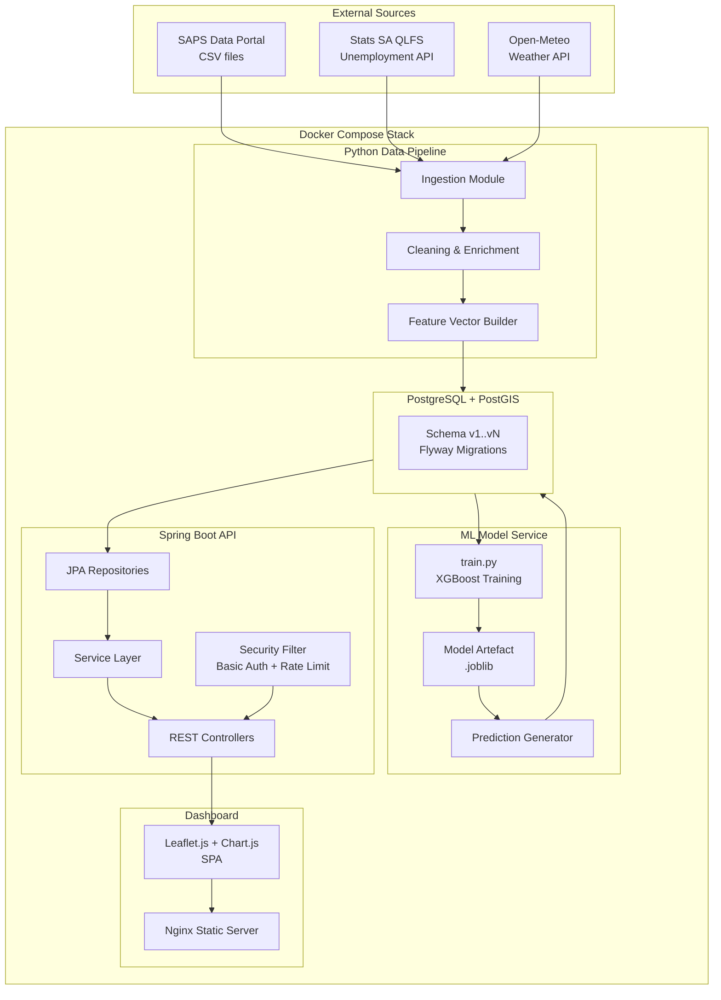

# Design Document: CrimecastZA

## Overview

CrimecastZA is a South African Crime Hotspot Forecasting System composed of five integrated components:
a Python ETL pipeline, an XGBoost ML model, a PostgreSQL/PostGIS database, a Java Spring Boot REST API,
and an HTML/JavaScript Leaflet.js dashboard. All components are containerised with Docker and orchestrated
via Docker Compose, with a GitHub Actions CI/CD pipeline.

The system ingests SAPS quarterly crime statistics, enriches them with socioeconomic and environmental
data, trains a regression model to forecast monthly crime counts per police station and crime category,
and exposes those forecasts through a REST API and interactive web dashboard.

### Key Design Decisions

- **XGBoost over deep learning**: XGBoost provides strong performance on tabular data with limited
  training samples (SAPS publishes quarterly, so historical depth is bounded). It is interpretable,
  fast to train, and well-supported by joblib serialisation. Deep learning architectures require
  significantly more data and compute to outperform gradient boosting on structured crime statistics.
- **PostGIS for geospatial storage**: Province-boundary queries and station proximity lookups require
  proper spatial indexing. PostGIS GIST indexes on geometry columns deliver sub-500ms query times
  at the required dataset scale.
- **Flyway for schema migrations**: Flyway integrates natively with Spring Boot, runs migrations
  before the application context starts, and provides idempotent versioned scripts — satisfying
  Requirement 3.6 and 3.7 without a separate migration container.
- **Bucket4j for rate limiting**: In-process token-bucket rate limiting per client IP via a Spring
  `HandlerInterceptor` avoids an external Redis dependency while meeting the 100 req/60s requirement.
- **Temporal train/test split**: Crime data is time-ordered; random splits would leak future
  information into training. A strict temporal split (training up to 12 months before the latest
  quarter, holdout = last 12 months) prevents data leakage and produces honest MAPE estimates.

---

## Architecture

The system follows a layered pipeline architecture with clear separation between data ingestion,
model training, data serving, and presentation.



### Component Interaction Flow

1. **Quarterly trigger**: The Spring Boot `Retraining_Job` (Spring `@Scheduled`) fires on the first
   day of each quarter at 00:00 UTC.
2. **Data ingestion**: The job invokes the Python pipeline via `ProcessBuilder`, which downloads,
   cleans, enriches, and loads data into PostgreSQL.
3. **Model training**: `train.py` reads Feature_Vectors from PostgreSQL, performs a temporal split,
   trains XGBoost, evaluates MAPE, and serialises the artefact if the threshold is met.
4. **Forecast generation**: The prediction script reads the latest model artefact and writes
   Forecast rows for all stations and categories for the next calendar month.
5. **API serving**: Spring Boot controllers query PostgreSQL via Spring Data JPA + Hibernate Spatial
   and return JSON responses.
6. **Dashboard**: The SPA fetches data from the API and renders the Leaflet map and Chart.js charts.

---

## Components and Interfaces

### 1. Python Data Pipeline (`pipeline/`)

**Modules:**

| Module | Responsibility |
|---|---|
| `downloader.py` | HTTP download of SAPS CSV files; retry logic for Open-Meteo |
| `validator.py` | Column presence and type validation for SAPS files |
| `cleaner.py` | Name standardisation (trim, title-case, canonical matching), deduplication, quarterly→monthly conversion |
| `enricher.py` | Joins crime records with unemployment, weather, and calendar data |
| `feature_builder.py` | Assembles Feature_Vector rows and writes to DB |
| `logger.py` | Structured JSON log emitter (step, recordsProcessed, recordsSkipped, elapsedMs) |
| `pipeline.py` | Orchestration entry point; records Pipeline_Run_Log |

**Key interfaces:**

```python
# validator.py
def validate_saps_file(filepath: str, required_columns: list[str]) -> ValidationResult:
    """Returns ValidationResult(ok=True) or ValidationResult(ok=False, errors=[...])"""

# cleaner.py
def clean_record(raw: dict) -> CleanedRecord:
    """Returns CleanedRecord with original_name, canonical_name, monthly_count"""

def monthly_count(quarterly_count: int) -> int:
    """Returns floor(quarterly_count / 3)"""

# feature_builder.py
def build_feature_vector(station_id: int, category_id: int, year: int, month: int,
                          db_conn) -> FeatureVector:
    """Joins all data sources and returns a complete FeatureVector"""
```

### 2. ML Model Service (`model/`)

**Scripts:**

| Script | Responsibility |
|---|---|
| `train.py` | Loads Feature_Vectors, temporal split, XGBoost training, MAPE evaluation, serialisation |
| `predict.py` | Loads artefact, generates Forecasts for all stations/categories, writes to DB |
| `risk_scorer.py` | Derives Risk_Score (1–5) from percentile ranking against historical distribution |

**Key interfaces:**

```python
# train.py
def temporal_split(df: pd.DataFrame, cutoff_months: int = 12) -> tuple[pd.DataFrame, pd.DataFrame]:
    """Returns (train_df, test_df) with strict temporal boundary"""

def evaluate_mape(model, X_test, y_test) -> dict[str, float]:
    """Returns {crime_category: mape_value} for all categories in test set"""

# risk_scorer.py
def compute_risk_score(predicted_count: float, historical_counts: list[float],
                        province: str, category: str) -> int:
    """Returns integer 1-5 based on 20th-percentile ranking"""
```

### 3. Spring Boot REST API (`api/`)

**Package structure:**

```
com.crimecastza.api
├── controller/
│   ├── ForecastController.java      # /api/v1/forecasts, /api/v1/hotspots
│   ├── TrendController.java         # /api/v1/trends, /api/v1/stations
│   └── AdminController.java         # /api/v1/admin/retrain
├── service/
│   ├── ForecastService.java
│   ├── TrendService.java
│   └── RetrainingJobService.java
├── repository/
│   ├── ForecastRepository.java      # Spring Data JPA
│   ├── StationRepository.java       # Hibernate Spatial for PostGIS
│   └── TrendRepository.java
├── model/                           # JPA entities
├── dto/                             # Request/response DTOs
├── security/
│   ├── BasicAuthConfig.java         # HTTP Basic for /admin/**
│   └── RateLimitInterceptor.java    # Bucket4j per-IP rate limiting
├── exception/
│   └── GlobalExceptionHandler.java  # @ControllerAdvice for 400/404/429
└── scheduler/
    └── RetrainingScheduler.java     # @Scheduled quarterly job
```

**REST API surface:**

| Method | Path | Description |
|---|---|---|
| GET | `/api/v1/forecasts` | Paginated forecasts with optional filters |
| GET | `/api/v1/forecasts/{stationId}` | Forecasts for a station (current + next month) |
| GET | `/api/v1/hotspots` | Stations meeting risk threshold |
| GET | `/api/v1/trends/{stationId}` | Historical trend for a station |
| GET | `/api/v1/trends/province/{provinceId}` | Aggregated provincial trend |
| GET | `/api/v1/stations` | All stations with coordinates |
| POST | `/api/v1/admin/retrain` | Trigger immediate retraining (admin only) |
| GET | `/actuator/health` | Health check |
| GET | `/swagger-ui.html` | OpenAPI documentation |

### 4. Dashboard (`dashboard/`)

**Files:**

| File | Responsibility |
|---|---|
| `index.html` | SPA shell with filter controls and layout |
| `map.js` | Leaflet.js map initialisation, marker rendering, popup content |
| `charts.js` | Chart.js line chart (trends) and bar chart (top stations) |
| `filters.js` | Filter state management and API call orchestration |
| `export.js` | CSV export from current chart data |
| `api.js` | Fetch wrapper for all API calls |

### 5. Database (PostgreSQL + PostGIS)

Managed by Flyway migrations in `db/migrations/`. The Spring Boot API applies migrations on startup
via the `spring.flyway` auto-configuration.

---

## Data Models

### Database Schema (3NF, PostgreSQL + PostGIS)

```sql
-- V1__create_schema.sql

CREATE TABLE province (
    id          SERIAL PRIMARY KEY,
    name        VARCHAR(100) NOT NULL UNIQUE  -- e.g. 'Western Cape'
);

CREATE TABLE police_station (
    id              SERIAL PRIMARY KEY,
    canonical_name  VARCHAR(200) NOT NULL,
    original_name   VARCHAR(200) NOT NULL,     -- Req 1.8: audit traceability
    province_id     INTEGER NOT NULL REFERENCES province(id),
    location        GEOMETRY(Point, 4326) NOT NULL  -- PostGIS WGS84 point
);

CREATE INDEX idx_station_province ON police_station(province_id);
CREATE INDEX idx_station_location ON police_station USING GIST(location);

CREATE TABLE crime_category (
    id    SERIAL PRIMARY KEY,
    name  VARCHAR(200) NOT NULL UNIQUE  -- e.g. 'Assault GBH'
);

CREATE TABLE monthly_crime_record (
    id              SERIAL PRIMARY KEY,
    station_id      INTEGER NOT NULL REFERENCES police_station(id),
    category_id     INTEGER NOT NULL REFERENCES crime_category(id),
    year            SMALLINT NOT NULL,
    month           SMALLINT NOT NULL CHECK (month BETWEEN 1 AND 12),
    monthly_count   INTEGER NOT NULL CHECK (monthly_count >= 0),
    UNIQUE (station_id, category_id, year, month)
);

CREATE INDEX idx_crime_record_station ON monthly_crime_record(station_id);
CREATE INDEX idx_crime_record_category ON monthly_crime_record(category_id);
CREATE INDEX idx_crime_record_period ON monthly_crime_record(year, month);

CREATE TABLE unemployment_record (
    id           SERIAL PRIMARY KEY,
    province_id  INTEGER NOT NULL REFERENCES province(id),
    year         SMALLINT NOT NULL,
    quarter      SMALLINT NOT NULL CHECK (quarter BETWEEN 1 AND 4),
    rate         NUMERIC(5,2) NOT NULL,
    UNIQUE (province_id, year, quarter)
);

CREATE TABLE weather_record (
    id              SERIAL PRIMARY KEY,
    station_id      INTEGER NOT NULL REFERENCES police_station(id),
    year            SMALLINT NOT NULL,
    month           SMALLINT NOT NULL CHECK (month BETWEEN 1 AND 12),
    mean_temp_c     NUMERIC(5,2),
    total_precip_mm NUMERIC(7,2),
    UNIQUE (station_id, year, month)
);

CREATE TABLE calendar_event (
    id          SERIAL PRIMARY KEY,
    event_date  DATE NOT NULL UNIQUE,
    event_type  VARCHAR(20) NOT NULL CHECK (event_type IN ('public_holiday', 'payday')),
    is_flagged  BOOLEAN NOT NULL DEFAULT TRUE
);

CREATE TABLE feature_vector (
    id                  SERIAL PRIMARY KEY,
    station_id          INTEGER NOT NULL REFERENCES police_station(id),
    category_id         INTEGER NOT NULL REFERENCES crime_category(id),
    year                SMALLINT NOT NULL,
    month               SMALLINT NOT NULL,
    lag_1 THROUGH lag_12  INTEGER,  -- 12-month lagged crime counts
    unemployment_rate   NUMERIC(5,2),
    mean_temp_c         NUMERIC(5,2),
    total_precip_mm     NUMERIC(7,2),
    public_holiday_count SMALLINT,
    payday_count        SMALLINT,
    month_of_year       SMALLINT,
    UNIQUE (station_id, category_id, year, month)
);

CREATE TABLE forecast (
    id                  SERIAL PRIMARY KEY,
    station_id          INTEGER NOT NULL REFERENCES police_station(id),
    category_id         INTEGER NOT NULL REFERENCES crime_category(id),
    forecast_year       SMALLINT NOT NULL,
    forecast_month      SMALLINT NOT NULL CHECK (forecast_month BETWEEN 1 AND 12),
    predicted_count     NUMERIC(10,2) NOT NULL,
    risk_score          SMALLINT NOT NULL CHECK (risk_score BETWEEN 1 AND 5),
    model_version       VARCHAR(100) NOT NULL,
    created_at          TIMESTAMPTZ NOT NULL DEFAULT NOW(),
    UNIQUE (station_id, category_id, forecast_year, forecast_month, model_version)
);

CREATE INDEX idx_forecast_station ON forecast(station_id);
CREATE INDEX idx_forecast_category ON forecast(category_id);
CREATE INDEX idx_forecast_period ON forecast(forecast_year, forecast_month);

CREATE TABLE pipeline_run_log (
    id                  SERIAL PRIMARY KEY,
    run_start           TIMESTAMPTZ NOT NULL,
    run_end             TIMESTAMPTZ,
    status              VARCHAR(20) NOT NULL CHECK (status IN ('running','success','failed')),
    records_processed   INTEGER,
    records_skipped     INTEGER,
    mape_per_category   JSONB,   -- {"Assault GBH": 12.3, ...}
    error_message       TEXT
);
```

### Python Data Models

```python
@dataclass
class CleanedRecord:
    original_name: str
    canonical_name: str
    province: str
    category: str
    year: int
    month: int
    monthly_count: int

@dataclass
class FeatureVector:
    station_id: int
    category_id: int
    year: int
    month: int
    lags: list[int]          # 12 elements
    unemployment_rate: float
    mean_temp_c: float
    total_precip_mm: float
    public_holiday_count: int
    payday_count: int
    month_of_year: int

@dataclass
class ValidationResult:
    ok: bool
    errors: list[str] = field(default_factory=list)
```

### API DTOs (Java)

```java
// ForecastDto.java
public record ForecastDto(
    int stationId, String stationName, String province,
    String crimeCategory, int forecastYear, int forecastMonth,
    double predictedCount, int riskScore, String modelVersion
) {}

// HotspotDto.java
public record HotspotDto(
    int stationId, String stationName, String province,
    double latitude, double longitude, int riskScore
) {}

// TrendPointDto.java
public record TrendPointDto(
    String month,        // "YYYY-MM"
    int crimeCount,
    String dataType      // "historical" | "forecast"
) {}

// ErrorDto.java
public record ErrorDto(String message, Map<String, String> details) {}
```

---

## Correctness Properties

*A property is a characteristic or behavior that should hold true across all valid executions of a
system — essentially, a formal statement about what the system should do. Properties serve as the
bridge between human-readable specifications and machine-verifiable correctness guarantees.*

The following properties were derived from the prework analysis of all acceptance criteria. Properties
that were logically redundant (e.g., 5.1 duplicates 4.7; 15.6 duplicates 14.7) have been consolidated.
UI-only, infrastructure, and operational criteria are excluded from PBT and covered by integration or
smoke tests instead.

---

### Property 1: SAPS CSV column validation is universal

*For any* CSV file, the validator SHALL accept the file if and only if all required columns
(`police_station_name`, `province`, `crime_category`, `quarterly_count`) are present; for any file
missing one or more of those columns, the validator SHALL return a failed `ValidationResult`
identifying the missing columns.

**Validates: Requirements 1.2**

---

### Property 2: Data cleaning preserves original name and produces canonical name

*For any* raw police station name string, after applying the cleaning transformation, the resulting
`CleanedRecord` SHALL contain the original unmodified name in `original_name` and a trimmed,
title-cased canonical name in `canonical_name`, and the two fields SHALL be independently stored.

**Validates: Requirements 1.4, 1.8**

---

### Property 3: Quarterly-to-monthly conversion

*For any* non-negative integer quarterly crime count `q`, the monthly estimate SHALL equal
`floor(q / 3)`, and the result SHALL always be a non-negative integer.

**Validates: Requirements 1.4**

---

### Property 4: Open-Meteo retry with exponential backoff

*For any* sequence of API failures on attempts 1 through N (where N ≤ 3), the pipeline SHALL retry
with wait intervals of 1 s, 2 s, and 4 s respectively before logging a warning; if all three retries
fail, the pipeline SHALL continue processing remaining stations without halting.

**Validates: Requirements 2.4**

---

### Property 5: Feature_Vector completeness

*For any* valid combination of `station_id`, `category_id`, `year`, and `month` for which all source
data exists, the assembled `FeatureVector` SHALL contain non-null values for all 12 lag fields,
`unemployment_rate`, `mean_temp_c`, `total_precip_mm`, `public_holiday_count`, `payday_count`, and
`month_of_year`.

**Validates: Requirements 2.6, 4.6**

---

### Property 6: Referential integrity enforcement

*For any* insert or update operation that references a non-existent foreign key value (e.g., a
`monthly_crime_record` referencing a non-existent `station_id`), the database SHALL reject the
operation and return a constraint violation error without modifying any existing data.

**Validates: Requirements 3.4**

---

### Property 7: Migration idempotency

*For any* sequence of Flyway migration scripts, applying the full migration sequence twice to the
same database SHALL produce no errors on the second application and SHALL result in an identical
schema state as after the first application.

**Validates: Requirements 3.6**

---

### Property 8: Temporal train/test split correctness

*For any* Feature_Vector dataset with records spanning multiple months, the temporal split function
SHALL place all records dated within 12 months of the most recent available quarter into the test
set, and all earlier records into the training set, with no record appearing in both sets.

**Validates: Requirements 4.2**

---

### Property 9: Forecast coverage after retraining

*For any* successful retraining run, the system SHALL generate and store exactly one Forecast record
for every `(station_id, category_id)` combination present in the database for the forthcoming
calendar month, with no combination omitted.

**Validates: Requirements 4.7, 5.1**

---

### Property 10: Risk_Score percentile ranking

*For any* set of predicted crime counts for a given `Crime_Category` and `Province`, the assigned
`Risk_Score` values SHALL correctly reflect the 20th-percentile boundaries of the historical
distribution: the bottom 20% receive score 1, the next 20% receive score 2, and so on up to score 5
for the top 20%.

**Validates: Requirements 5.2**

---

### Property 11: Forecast record completeness

*For any* Forecast stored in the database, the record SHALL contain non-null values for `station_id`,
`category_id`, `forecast_year`, `forecast_month`, `predicted_count`, `risk_score`, and
`model_version`.

**Validates: Requirements 5.3**

---

### Property 12: API always serves the most recent forecast

*For any* `(station_id, category_id)` combination for which multiple Forecast records exist with
different `created_at` timestamps, the API SHALL return only the record with the latest `created_at`
timestamp.

**Validates: Requirements 5.4**

---

### Property 13: Forecast pagination correctness

*For any* valid request to `GET /api/v1/forecasts` with optional filter parameters, the response
SHALL be paginated with a page size between 1 and 100 inclusive (defaulting to 20), and the total
number of items across all pages SHALL equal the number of matching Forecast records in the database.

**Validates: Requirements 6.1**

---

### Property 14: API input validation returns HTTP 400 with parameter identification

*For any* request to a forecast or trend endpoint containing an invalid parameter type or
out-of-range value, the API SHALL return HTTP 400 with a JSON error body that names each invalid
parameter and states its expected type and valid range; no invalid input SHALL reach the database.

**Validates: Requirements 6.4, 13.1, 13.2**

---

### Property 15: Hotspot threshold filtering

*For any* `riskThreshold` value in [0.0, 1.0] and any dataset of Police_Station Risk_Scores, the
`GET /api/v1/hotspots` endpoint SHALL return exactly those stations whose current `Risk_Score`
(normalised to [0.0, 1.0] by dividing by 5) meets or exceeds the threshold, and SHALL exclude all
stations below the threshold.

**Validates: Requirements 6.5**

---

### Property 16: Invalid riskThreshold returns HTTP 400

*For any* `riskThreshold` value outside the range [0.0, 1.0] (including absent values), the API
SHALL return HTTP 400 with a JSON error body identifying the parameter and its valid range.

**Validates: Requirements 6.9**

---

### Property 17: Trend partial-overlap response includes dataRangeNote

*For any* trend request whose date range partially overlaps the available historical data, the API
SHALL return HTTP 200 with all records within the overlapping portion and a `dataRangeNote` field
stating the actual start and end months covered.

**Validates: Requirements 7.2**

---

### Property 18: Invalid identifier returns HTTP 404 with parameter identification

*For any* request to a trend or station endpoint containing an invalid `stationId`, `provinceId`,
or `crimeCategory` value, the API SHALL return HTTP 404 with a JSON error body that names the
invalid parameter and its submitted value.

**Validates: Requirements 7.6**

---

### Property 19: Retraining step ordering invariant

*For any* triggered retraining run (scheduled or manual), the steps SHALL execute in the order:
data ingestion → model training → forecast generation; no step SHALL begin before the preceding
step has completed successfully.

**Validates: Requirements 8.2**

---

### Property 20: Retraining run log completeness

*For any* completed or failed retraining run, the `Pipeline_Run_Log` entry SHALL contain non-null
values for `run_start`, `status`, `records_processed`, `records_skipped`, and `mape_per_category`
(or an error message if the run failed).

**Validates: Requirements 8.4**

---

### Property 21: Risk_Score colour mapping

*For any* Police_Station marker rendered on the dashboard map, the marker colour SHALL correspond
exactly to the station's current `Risk_Score` according to the fixed scale: 1 → `#1a9641`,
2 → `#a6d96a`, 3 → `#ffffbf`, 4 → `#fdae61`, 5 → `#d7191c`.

**Validates: Requirements 9.2**

---

### Property 22: Station popup field completeness

*For any* Police_Station marker clicked on the map, the popup SHALL display the station name,
Province, current `Risk_Score`, predicted crime count, and a sparkline of the past 12 months of
monthly crime counts.

**Validates: Requirements 9.3**

---

### Property 23: Line chart month count

*For any* selected `(station, crime_category)` combination, if 24 or more months of data are
available the chart SHALL display exactly the most recent 24 months; if fewer than 24 months are
available the chart SHALL display all available months; in both cases a Forecast value SHALL be
plotted as a distinct data point at the forecast month position.

**Validates: Requirements 10.1**

---

### Property 24: Bar chart top-N ranking

*For any* selected Province and Crime_Category, the bar chart SHALL display the top min(10, N)
Police_Stations ranked by descending `Risk_Score`, where N is the number of stations in the Province
with Risk_Score data for the selected category.

**Validates: Requirements 10.2**

---

### Property 25: Chart series visual distinction

*For any* chart displaying both historical actuals and Forecast values, historical actuals SHALL be
rendered as a solid line with circular markers and Forecast values SHALL be rendered as a dashed line
with filled square markers, with a legend identifying each series.

**Validates: Requirements 10.3**

---

### Property 26: Tooltip data correctness

*For any* data point on any chart, the tooltip displayed on hover SHALL show the exact month in
`YYYY-MM` format, the crime count value, and whether the value is `"historical"` or `"forecast"`.

**Validates: Requirements 10.4**

---

### Property 27: CSV export correctness

*For any* data currently displayed in the line chart, the exported CSV SHALL contain exactly the
columns `station_name`, `month` (format `YYYY-MM`), `crime_count`, `data_type` (values
`"historical"` or `"forecast"`), with one row per data point and no additional or missing rows.

**Validates: Requirements 10.5**

---

### Property 28: Missing environment variable causes non-zero exit

*For any* required environment variable that is absent when a service starts, the service SHALL log
a descriptive error message identifying the missing variable by name and SHALL exit with a non-zero
status code without starting normally.

**Validates: Requirements 11.5**

---

### Property 29: SQL injection rejection

*For any* string input to an API endpoint that contains a recognised SQL injection pattern (e.g.,
`' OR 1=1`, `; DROP TABLE`, `UNION SELECT`), the API SHALL return HTTP 400 with a JSON error body
and SHALL NOT pass the input to the database.

**Validates: Requirements 13.3**

---

### Property 30: Rate limiting per client IP

*For any* client IP address, after exactly 100 requests within a 60-second window, all subsequent
requests within that window SHALL receive HTTP 429 with a `Retry-After` header containing the
number of whole seconds remaining in the current window; the counter SHALL reset at the start of
each new 60-second window.

**Validates: Requirements 13.6, 13.7**

---

### Property 31: SAPS CSV parse type correctness

*For any* valid SAPS CSV file, the parser SHALL produce `Monthly_Crime_Record` objects where all
required fields are non-null, numeric fields (`quarterly_count`) are parsed as integers, and string
fields (`station_name`, `province`, `crime_category`) are parsed as strings.

**Validates: Requirements 14.1**

---

### Property 32: CSV parse error identifies row and field

*For any* malformed SAPS CSV file (missing required fields, type mismatches), the parser SHALL
return a descriptive error that identifies the row number and field name that caused the failure.

**Validates: Requirements 14.2**

---

### Property 33: CSV serialisation column order

*For any* `Monthly_Crime_Record` object, serialising it to CSV SHALL produce a file with identical
column names in identical order as the original SAPS source files.

**Validates: Requirements 14.3**

---

### Property 34: CSV round-trip fidelity

*For any* valid `Monthly_Crime_Record` object, the sequence parse → serialise → parse SHALL produce
an object with field values identical to the original object.

**Validates: Requirements 14.4**

---

### Property 35: Model serialisation round-trip

*For any* trained XGBoost model, serialising it to a `.joblib` file and deserialising it SHALL
produce a model object that generates identical predicted crime counts for a fixed set of reference
Feature_Vectors as the original in-memory model.

**Validates: Requirements 14.6**

---

### Property 36: API request log completeness

*For any* HTTP request received by the API, the emitted structured JSON log entry SHALL contain
non-null values for `method`, `path`, `statusCode`, `responseTimeMs`, and `correlationId`; the
`correlationId` SHALL equal the `X-Correlation-ID` request header value if present, or a newly
generated UUID if absent.

**Validates: Requirements 15.3**

---

### Property 37: Data pipeline log completeness

*For any* pipeline processing step, the emitted structured JSON log entry SHALL contain non-null
values for `step`, `recordsProcessed`, `recordsSkipped`, and `elapsedMs`.

**Validates: Requirements 15.4**

---

## Error Handling

### Python Data Pipeline

| Scenario | Behaviour |
|---|---|
| SAPS portal unreachable / HTTP error | Log error (URL, status, timestamp); abort run; no DB writes |
| SAPS file fails column validation | Log error (filename, missing columns, timestamp); skip file; continue |
| QLFS source unreachable | Log warning; use most recently stored unemployment rates |
| Open-Meteo error for a station | Retry up to 3× with 1s/2s/4s backoff; log warning; continue |
| DB write failure | Log error with exception; mark run as failed in Pipeline_Run_Log |
| Missing environment variable | Log error naming the variable; exit non-zero |

### ML Model Service

| Scenario | Behaviour |
|---|---|
| MAPE ≥ 15% for < 5 categories | Log warning with per-category MAPE; do NOT replace existing artefact |
| No prior artefact and MAPE threshold not met | Record failed-training status in DB; exit without persisting model |
| joblib serialisation failure | Emit ERROR-level JSON log (file path, exception); exit non-zero |
| Retraining step timeout (> 4 hours) | Treat as failure; log timeout error; halt subsequent steps |

### Spring Boot API

| Scenario | HTTP Status | Response Body |
|---|---|---|
| Invalid parameter type or range | 400 | `{"message": "...", "details": {"param": "expected format"}}` |
| Missing required parameter | 400 | `{"message": "Missing required parameter: <name>"}` |
| SQL injection pattern detected | 400 | `{"message": "Invalid input detected"}` |
| Resource not found (stationId, etc.) | 404 | `{"message": "...", "details": {"param": "value"}}` |
| No forecast for combination | 404 | `{"message": "No forecast available for station X, category Y"}` |
| Unauthenticated admin request | 401 | `WWW-Authenticate: Basic realm="CrimecastZA Admin"` |
| Incorrect admin credentials | 403 | `{"message": "Provided credentials are not authorised"}` |
| Rate limit exceeded | 429 | `Retry-After: <seconds>` + `{"message": "Rate limit exceeded"}` |
| Retrain already in progress | 409 | `{"message": "A retraining run is already active"}` |
| DB unavailable (health check) | 503 | `{"status": "DOWN", "components": {"db": {"status": "DOWN"}}}` |

### Global Exception Handler

A Spring `@ControllerAdvice` (`GlobalExceptionHandler`) catches:
- `MethodArgumentTypeMismatchException` → 400
- `ConstraintViolationException` → 400
- `EntityNotFoundException` → 404
- `DataIntegrityViolationException` → 409
- Unhandled exceptions → 500 with sanitised message (no stack traces in production)

All error responses use the `ErrorDto` record and are serialised as `application/json`.

### Docker Compose Startup Errors

- If a Flyway migration fails, the Spring Boot container exits with code 1, logs the failed script
  name and error, and the Docker Compose health check for the `db-init` service remains unhealthy,
  preventing the `api` service from starting (via `depends_on: condition: service_healthy`).
- If a required environment variable is absent, the affected service logs the variable name and
  exits with code 1 before attempting any connections.

---

## Testing Strategy

### Overview

CrimecastZA uses a dual testing approach: property-based tests for universal correctness properties
and example-based unit/integration tests for specific scenarios, edge cases, and infrastructure
verification.

### Property-Based Testing

**Library choices:**
- Python pipeline and ML model: [Hypothesis](https://hypothesis.readthedocs.io/) (mature, well-integrated with pytest)
- Java Spring Boot API: [jqwik](https://jqwik.net/) (JUnit 5 compatible, supports arbitrary generators)
- JavaScript dashboard: [fast-check](https://fast-check.dev/) (TypeScript-compatible, Jest integration)

**Configuration:** Each property test runs a minimum of 100 iterations. Tests are tagged with a
comment referencing the design property they validate.

**Tag format:** `Feature: crimecast-za, Property <N>: <property_text>`

**Properties mapped to tests:**

| Property | Component | Library | Test File |
|---|---|---|---|
| 1 – CSV column validation | Python pipeline | Hypothesis | `test_validator.py` |
| 2 – Name cleaning preserves original | Python pipeline | Hypothesis | `test_cleaner.py` |
| 3 – Quarterly-to-monthly conversion | Python pipeline | Hypothesis | `test_cleaner.py` |
| 4 – Open-Meteo retry backoff | Python pipeline | Hypothesis | `test_downloader.py` |
| 5 – Feature_Vector completeness | Python pipeline | Hypothesis | `test_feature_builder.py` |
| 6 – Referential integrity | Database | pytest + psycopg2 | `test_schema.py` |
| 7 – Migration idempotency | Database | pytest + psycopg2 | `test_migrations.py` |
| 8 – Temporal split correctness | ML model | Hypothesis | `test_train.py` |
| 9 – Forecast coverage | ML model | Hypothesis | `test_predict.py` |
| 10 – Risk_Score percentile ranking | ML model | Hypothesis | `test_risk_scorer.py` |
| 11 – Forecast record completeness | ML model | Hypothesis | `test_predict.py` |
| 12 – API serves most recent forecast | Java API | jqwik | `ForecastServiceTest.java` |
| 13 – Pagination correctness | Java API | jqwik | `ForecastControllerTest.java` |
| 14 – Input validation → HTTP 400 | Java API | jqwik | `ValidationTest.java` |
| 15 – Hotspot threshold filtering | Java API | jqwik | `HotspotControllerTest.java` |
| 16 – Invalid riskThreshold → HTTP 400 | Java API | jqwik | `HotspotControllerTest.java` |
| 17 – Trend partial-overlap dataRangeNote | Java API | jqwik | `TrendControllerTest.java` |
| 18 – Invalid identifier → HTTP 404 | Java API | jqwik | `TrendControllerTest.java` |
| 19 – Retraining step ordering | Java API | jqwik | `RetrainingJobServiceTest.java` |
| 20 – Run log completeness | Java API | jqwik | `RetrainingJobServiceTest.java` |
| 21 – Risk_Score colour mapping | Dashboard | fast-check | `map.test.js` |
| 22 – Popup field completeness | Dashboard | fast-check | `map.test.js` |
| 23 – Line chart month count | Dashboard | fast-check | `charts.test.js` |
| 24 – Bar chart top-N ranking | Dashboard | fast-check | `charts.test.js` |
| 25 – Chart series visual distinction | Dashboard | fast-check | `charts.test.js` |
| 26 – Tooltip data correctness | Dashboard | fast-check | `charts.test.js` |
| 27 – CSV export correctness | Dashboard | fast-check | `export.test.js` |
| 28 – Missing env var → non-zero exit | All services | Hypothesis/jqwik | `test_env.py`, `EnvVarTest.java` |
| 29 – SQL injection rejection | Java API | jqwik | `SecurityTest.java` |
| 30 – Rate limiting per IP | Java API | jqwik | `RateLimitTest.java` |
| 31 – CSV parse type correctness | Python pipeline | Hypothesis | `test_parser.py` |
| 32 – CSV parse error identification | Python pipeline | Hypothesis | `test_parser.py` |
| 33 – CSV serialisation column order | Python pipeline | Hypothesis | `test_parser.py` |
| 34 – CSV round-trip fidelity | Python pipeline | Hypothesis | `test_parser.py` |
| 35 – Model serialisation round-trip | ML model | Hypothesis | `test_train.py` |
| 36 – API request log completeness | Java API | jqwik | `LoggingTest.java` |
| 37 – Pipeline log completeness | Python pipeline | Hypothesis | `test_logger.py` |

### Example-Based Unit Tests

Unit tests cover specific scenarios not suited to property-based testing:

- **Pipeline**: SAPS portal unreachable (mock HTTP 500), QLFS fallback to cached rates,
  run log entry written after completion, pipeline completes without human interaction.
- **ML model**: MAPE threshold met → model serialised; MAPE threshold not met → existing model
  retained; serialisation failure → ERROR log + non-zero exit.
- **API**: `GET /api/v1/forecasts/{stationId}` returns current and next month; HTTP 404 for
  invalid stationId; HTTP 200 with empty array for valid station with no forecasts; HTTP 401 for
  unauthenticated admin request; HTTP 403 for incorrect credentials; HTTP 409 for concurrent
  retrain; API continues serving forecasts during retraining; health endpoint returns 200/503.
- **Dashboard**: Legend displays correct colour scale; default filters on load; empty map message
  when no stations match; empty chart message with hidden Export CSV button; bar chart note for
  fewer than 10 stations.

### Integration Tests

Integration tests verify infrastructure wiring and performance requirements:

- **Database**: Geospatial query returns results within 500ms for 1,000+ stations; all required
  tables and indexes exist after migration; data persists across container restarts.
- **API**: All endpoints respond within 2,000ms under 100 concurrent requests; trend endpoints
  respond within 3,000ms (≤ 60 months) and 10,000ms (> 60 months); `docker-compose up` starts
  all services within 120 seconds; Docker images reach running state within 30 seconds.
- **Pipeline**: SAPS data loaded for ≥ 30 stations across all 9 provinces; unemployment, weather,
  and calendar data loaded correctly; Feature_Vectors loadable by single SQL SELECT.

### Smoke Tests

Smoke tests verify one-time configuration and setup:

- All required Docker Compose services defined; named volume present; `.env.example` complete.
- Flyway migrations applied; all required tables, indexes, and geometry columns present.
- Swagger UI accessible at `/swagger-ui.html`; CORS headers present for configured origins.
- GitHub Actions trigger configuration; stage ordering; coverage threshold configured.
- XGBoost training script runs standalone; cron expression correctly configured.

### CI/CD Test Execution

The GitHub Actions pipeline runs tests in this order:
1. Python unit + property tests (`pytest --hypothesis-seed=0`)
2. Java unit + property tests (`mvn test`)
3. Java integration tests with Testcontainers PostgreSQL (`mvn verify -P integration`)
4. Java API line coverage check (JaCoCo, threshold 90%)
5. Docker image build and health check verification
6. Docker image push to container registry (main branch only)
